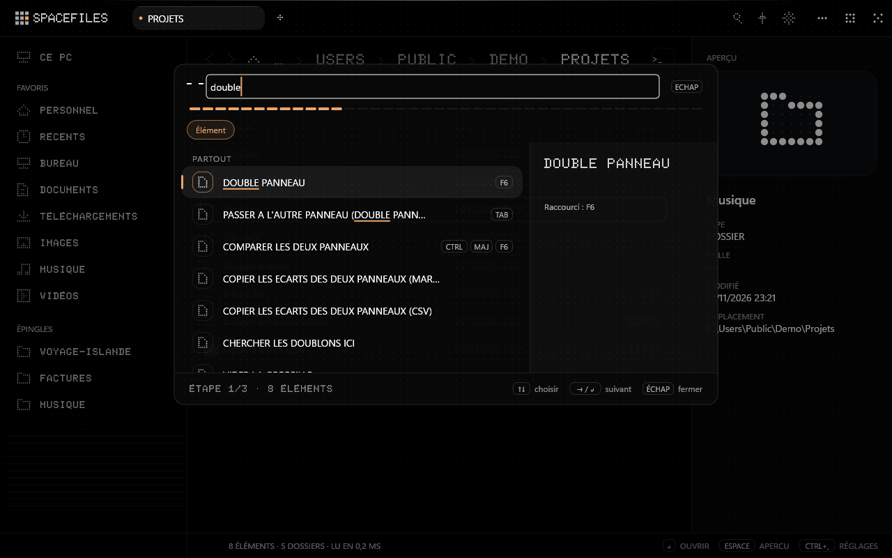
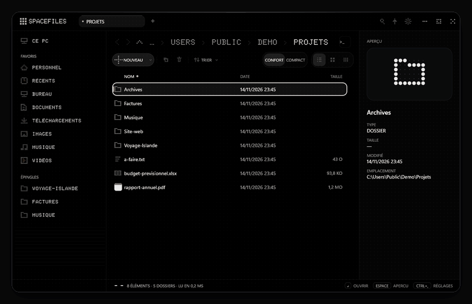

<p align="right"><a href="README.md">English</a> · <b>Français</b></p>

<p align="center">
  
</p>

<h3 align="center">L'explorateur de fichiers pour Windows 11 qui se lit d'un coup d'œil.</h3>

<p align="center">
  Double panneau. Palette de commandes. Vraie annulation. Look matrice de points.<br>
  <sub>Rust, Win32 natif, Direct2D · pas de framework d'interface · pas de télémétrie · 4,4 Mo</sub>
</p>

<p align="center">
  <a href="https://github.com/nicoo-o/SpaceFiles/releases/latest"></a>
  &nbsp;
  <a href="#le-compiler-soi-même"></a>
</p>

<p align="center">
  
  
  
  
  
  
  <a href="LICENSE"></a>
</p>

<p align="center">
  <a href="#pourquoi-ça-existe">Pourquoi</a> ·
  <a href="#ce-que-vous-obtenez">Fonctions</a> ·
  <a href="#voir">Captures</a> ·
  <a href="#face-à-lexplorateur-windows">Face à l'Explorateur</a> ·
  <a href="#peut-on-faire-confiance-à-un-exe-non-signé">Confiance</a> ·
  <a href="#le-compiler-soi-même">Compiler</a> ·
  <a href="#limites-connues">Limites</a>
</p>

<p align="center">
  
</p>

<p align="center">
  <br>
  <sub>Un tour de cinq vues (liste, grille, double panneau, palette, coup d'œil), assemblé à partir de vraies captures d'un dossier de démonstration.</sub>
</p>

---

## Pourquoi ça existe

> L'Explorateur de Windows est fait pour tout le monde. SpaceFiles est fait pour une personne qui veut circuler
> au clavier, voir deux endroits à la fois, annuler une erreur, et que le tout ressemble à un téléphone Nothing.

Une fenêtre sans bordure, fond noir, une seule police en matrice de points (Doto), des menus qui crient poliment
en majuscules. C'est l'explorateur de fichiers de la [suite Space](https://github.com/nicoo-o) : de petites
applications Windows natives et privées qui travaillent ensemble. Il s'appelait *Nothing Explorer* jusqu'en novembre 2026.

## Ce que vous obtenez

<table>
<tr>
<td width="33%" valign="top">

**🪟 Double panneau**<br>
<kbd>F6</kbd> coupe la fenêtre. Comparer deux dossiers, les synchroniser avec <kbd>Ctrl</kbd>+<kbd>Maj</kbd>+<kbd>F6</kbd>, copier les écarts en Markdown.

</td>
<td width="33%" valign="top">

**⌨️ Palette de commandes**<br>
<kbd>Ctrl</kbd>+<kbd>K</kbd> et on tape. Chaque commande à une frappe. Chemin modifiable avec <kbd>Ctrl</kbd>+<kbd>L</kbd>.

</td>
<td width="33%" valign="top">

**👁 Coup d'œil**<br>
<kbd>Espace</kbd> sur un fichier l'affiche. Sur un dossier, calcule sa taille. Plus un volet d'aperçu.

</td>
</tr>
<tr>
<td valign="top">

**↩️ Vraie annulation**<br>
Copier, déplacer et mettre à la corbeille passent par `IFileOperation` de Windows : <kbd>Ctrl</kbd>+<kbd>Z</kbd> / <kbd>Ctrl</kbd>+<kbd>Y</kbd>, 50 niveaux. File d'opérations avec pause et reprise.

</td>
<td valign="top">

**🔎 Recherche**<br>
Taper pour filtrer, <kbd>Ctrl</kbd>+<kbd>F</kbd> pour chercher en dessous. Index maison : 2,5 millions d'éléments en environ 4 min 30 s, 110 Mo.

</td>
<td valign="top">

**🎨 Trois vues, deux thèmes**<br>
Liste, grille, colonnes Miller. Sombre, clair ou auto. Le mouvement réduit coupe toute animation.

</td>
</tr>
</table>

<details>
<summary><b>Plus de détails</b> (onglets, étiquettes, renommage, téléchargements, le Pixel)</summary>

- **Onglets** : <kbd>Ctrl</kbd>+<kbd>T</kbd> / <kbd>W</kbd> / <kbd>Tab</kbd> ; sessions enregistrées 2 s après tout changement et rouvertes après un plantage.
- **Filtres de l'index** : `ext:` `taille>` `modif:` `dossier:` `dans:` `contenu:`.
- **Renommage en lot** par expressions régulières, étiquettes (<kbd>Ctrl</kbd>+<kbd>1</kbd>/<kbd>2</kbd>/<kbd>3</kbd>), épingles, SHA-256, archives.
- **Vue des conflits** côte à côte, et une jauge de 16 barres qui se termine par `ANNULER · CTRL Z`.
- **Téléchargements du navigateur** surveillés : les `.crdownload` et `.part` partiels ont leur pastille, les finis une marque `NOUVEAU`.
- **Pixel** : deux barres dans la barre d'état. Elles changent de couleur avec l'heure et ferment les yeux la nuit. Pas une mascotte : un voyant.
- <kbd>Win</kbd>+<kbd>E</kbd> ouvre SpaceFiles quand le petit processus résident tourne.

</details>

## Voir

<p align="center">
  
  
  
  
  
  
</p>
<p align="center"><sub>Un dossier de démonstration avec des fichiers inventés.</sub></p>

## Face à l'Explorateur Windows

Pas un verdict : une liste de ce qui diffère. L'Explorateur de Windows est mieux intégré au shell, au nuage et à
tous les autres programmes ; SpaceFiles ne cherche pas à le remplacer.

| | Explorateur (Windows 11) | SpaceFiles |
|---|---|---|
| Double panneau | non | **oui** (<kbd>F6</kbd>), avec comparaison de dossiers |
| Colonnes Miller | non | **oui** |
| Palette de commandes | non | **oui** (<kbd>Ctrl</kbd>+<kbd>K</kbd>) |
| Recherche | index Windows Search | index maison, avec filtres |
| Interface | système | matrice de points, une police, sombre et clair |
| Langue | celle de votre système | français seulement |
| Signé par Microsoft | **oui** | non |

## Télécharger

**[▶ Dernière version](https://github.com/nicoo-o/SpaceFiles/releases/latest)** : `SpaceFiles-v0.1.0-portable.zip` et
`SHA256SUMS.txt`. Décompresser, lancer `spacefiles.exe`. Windows 11. Première pré-version : non signée, sans mise à
jour automatique.

## Peut-on faire confiance à un exe non signé ?

On vous demande de lancer un programme venu d'un inconnu. Voici ce qui est vrai, et comment le vérifier.

<details>
<summary><b>Ouvrir la liste</b></summary>

- **Windows vous avertira.** L'exe n'a pas de certificat de signature de code (il est payant ; voir
  [`docs/release/signature-et-mises-a-jour.md`](docs/release/signature-et-mises-a-jour.md)). SmartScreen affiche
  « Windows a protégé votre PC » : cliquer sur **Informations complémentaires**, puis **Exécuter quand même**. Si
  Smart App Control est actif, il peut refuser le fichier net ; c'est la règle de Windows, pas quelque chose à contourner ici.
- **Vérifier le fichier.** La release porte `SHA256SUMS.txt`. Dans PowerShell :
  `Get-FileHash .\SpaceFiles-v0.1.0-portable.zip -Algorithm SHA256` doit afficher la même empreinte.
- **Aucune télémétrie, aucun compte, aucune recherche de mise à jour.** La seule connexion sortante du code est un
  test d'accessibilité sur le port 445 d'un stockage réseau que vous avez configuré vous-même.
- **Ce qu'il écrit.** Réglages et caches dans `%APPDATA%\SpaceFiles` et `%LOCALAPPDATA%\SpaceFiles`. Dans le code
  source, la seule écriture dans le registre est le réglage facultatif « explorateur par défaut »
  (<kbd>Win</kbd>+<kbd>E</kbd>) ; le zip n'a pas d'installeur.
- **Lire le code.** Il est entièrement ici, sous licence MIT. Windows 10 n'a pas été testé.

</details>

## Mesuré, pas affirmé

| Quoi | Mesuré | Note |
|---|---|---|
| Exécutable | **4,43 Mo** (4 433 920 octets) | build release, LTO, `panic = abort`, police Doto embarquée (+0,46 Mo), 14 novembre 2026 |
| Processus résident | **16 Mo** de working set | la part qui reste en mémoire pour <kbd>Win</kbd>+<kbd>E</kbd> |
| Dossier de 200 000 entrées | listé en **0,9 s**, 195 Mo | une seule mesure, pas une moyenne |
| Index de 2,5 millions d'éléments | ~4 min 30 s, 110 Mo | exploration à basse priorité |
| Tests | **692 réussis**, 0 échec, 8 ignorés | `cargo test`, 14 novembre 2026 |
| Dépendances directes | 4 crates (30 au total) | `windows`, `windows-core`, `regex`, `webview2-com` |

## Dans la suite Space

<details>
<summary><b>Comment les applications se parlent</b></summary>

SpaceFiles dialogue avec les autres applications Space par des tubes nommés réservés à l'utilisateur courant
(`Eco.<app>.<utilisateur>`, lignes JSON), un manifeste et un fichier de réglages partagé. Aucun port en écoute, aucun compte.

- [**SpaceHub**](https://github.com/nicoo-o/SpaceHub) : le point de rencontre de la suite. Il liste les applications,
  leurs versions et leur santé, et porte les réglages de thème et de mouvement que SpaceFiles suit.
- [**SpaceNotch**](https://github.com/nicoo-o/SpaceNotch) : la Dynamic Island de Windows 11. Il peut demander des
  recherches de fichiers à SpaceFiles, et SpaceFiles lui envoie l'avancement de ses opérations.
  <kbd>Alt</kbd>+<kbd>Espace</kbd> appartient à SpaceNotch ; c'est pourquoi la palette ici est <kbd>Ctrl</kbd>+<kbd>K</kbd>.
- Le contrat est écrit dans [`docs/ecosystem/protocol.md`](docs/ecosystem/protocol.md). Le Hub n'est jamais
  obligatoire, et aucune application n'en lance une autre pour fonctionner.

</details>

## Le compiler soi-même

Windows 11 et une chaîne Rust. Rien d'autre à installer.

```powershell
cargo build --release      # target\release\spacefiles.exe
cargo test                 # environ une demi-minute
./installer.ps1            # copie l'exe dans %LOCALAPPDATA%\Programs\SpaceFiles, raccourci et icône
```

Lire [`docs/installation.md`](docs/installation.md) avant de lancer l'installeur : il explique ce qui est écrit
et comment `desinstaller.ps1` l'enlève (vos données sont gardées sauf demande contraire).

## Limites connues

- **Pré-version, pas de binaire signé, pas de mise à jour automatique.** L'exe déclenche SmartScreen. WebView2 est facultatif (aperçu HTML seulement).
- **Le zip est portable : pas d'installeur.** `installer.ps1` ne marche que depuis les sources (raccourci, processus résident, <kbd>Win</kbd>+<kbd>E</kbd>).
- **Français seulement.** Interface, commentaires et documentation sont en français.
- SFTP, WebDAV, sauvegarde NAS et MTP sont gelés derrière un réglage `experimental`, désactivé pour un nouveau profil.
- Non couvert par les vérifications automatiques : tout ce qui demande une vraie souris (survol, menu clic droit, lasso), un second écran à autre DPI, le plein écran.
- La liste complète, sans l'adoucir, est à la fin de [`CHANGELOG.md`](CHANGELOG.md).

<details>
<summary><b>Ce que SpaceFiles ne fera pas</b></summary>

- **Pas de compte, pas de service distant** : ni Drive, Dropbox ou iCloud, ni fichier envoyé à un modèle.
- **Pas de télémétrie, pas de recommandations personnalisées** : le volet « recommandé » de l'Explorateur n'est pas un objectif.
- **Pas de mise à jour automatique en arrière-plan** : le binaire se remplace à la main.
- **Pas de moteur d'archives maison** : `tar.exe` couvre zip, tar et 7z dans les deux sens.
- **Pas de marché d'extensions, pas d'application mobile** : un auteur, un binaire.

</details>

## À propos

Fait par une personne, avec beaucoup d'aide d'agents de code ; [`AGENTS.md`](AGENTS.md) est leur règlement, et une
visite du code correcte pour les humains aussi. Le titre en points est généré par
[`tools/readme/titre.mjs`](tools/readme/titre.mjs).

[MIT](LICENSE). Les polices de `assets/fonts` gardent leurs propres licences.

<p align="center"><sub>Si ce genre d'outil vous plaît, une ⭐ aide les autres à le trouver.</sub></p>
