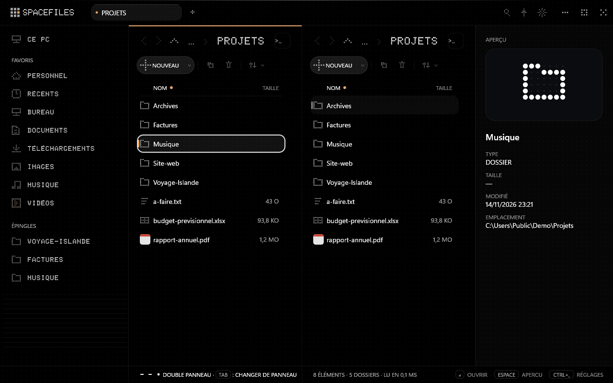
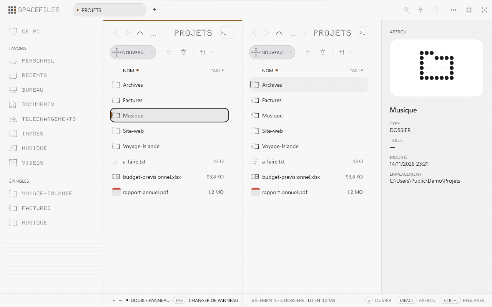

<p align="right"><b>English</b> · <a href="README.fr.md">Français</a></p>

<p align="center">
  
</p>

<p align="center">
  <b>A file explorer for Windows 11 that is drawn dot by dot.</b><br>
  Rust, raw Win32, Direct2D. No UI framework, no telemetry. The only web view is the optional HTML quick look
  (WebView2, scripts and network off).
</p>

<p align="center">
  <a href="https://github.com/nicoo-o/SpaceFiles/releases/latest"><b>▶ DOWNLOAD v0.1.0 (pre-release) · portable zip · Windows 11</b></a><br>
  <sub>Unsigned executable: Windows will warn you. <a href="#trust-">Read why, and how to check the file ▸</a></sub>
</p>

<p align="center">
  
</p>

<p align="center">
  <code>4.43 MB exe</code> · <code>16 MB resident</code> · <code>692 tests</code> · <code>1 optional web view</code>
</p>

---

> **STATE ▸ FIRST PRE-RELEASE (v0.1.0).** A portable zip is published; it is not signed and not updated
> automatically. What is missing is listed under [KNOWN LIMITS ▸](#known-limits-). If a number is on this page, it was measured.

## TRUST ▸

You are asked to run an unsigned program from a stranger. Here is what is true, and how to check it yourself.

- **Windows will warn you.** The exe has no code-signing certificate (it costs money; see
  [`docs/release/signature-et-mises-a-jour.md`](docs/release/signature-et-mises-a-jour.md)). SmartScreen shows
  "Windows protected your PC": click **More info**, then **Run anyway**. Smart App Control, if enabled, may refuse
  the file outright; that is Windows' rule, not something to bypass here.
- **Check the file.** The release carries `SHA256SUMS.txt`. In PowerShell:
  `Get-FileHash .\SpaceFiles-v0.1.0-portable.zip -Algorithm SHA256` must print the same hash.
- **No telemetry, no account, no update check.** The only outgoing connection in the code is a port-445
  reachability test toward a network storage you configured yourself.
- **What it writes.** Its settings and caches go to `%APPDATA%\SpaceFiles` and `%LOCALAPPDATA%\SpaceFiles`. In the
  source, the only code that writes to the registry is the optional "default explorer" setting (<kbd>Win</kbd>+<kbd>E</kbd>);
  the zip has no installer.
- **Read the code.** It is all here, under the MIT licence. Windows 10 has not been tested.

## SEE ▸

<p align="center">
  
  
  
  
  
  
</p>
<p align="center"><sub>A demo folder with made-up files; the interface is in French (see the known limits).</sub></p>

## VERSUS FILE EXPLORER ▸

Not a verdict: a list of what differs. Windows' own File Explorer is better integrated with the shell, the cloud
and every other program; SpaceFiles does not try to replace that.

| | File Explorer (Windows 11) | SpaceFiles |
|---|---|---|
| Dual pane | no | yes (<kbd>F6</kbd>), with folder comparison |
| Miller columns | no | yes |
| Command palette | no | yes (<kbd>Ctrl</kbd>+<kbd>K</kbd>) |
| Search | Windows Search index | home-made index, with filters |
| Language | your system language | French only |
| Signed by Microsoft | yes | no |
| Interface | system | dot-matrix, one font, dark and light |

## OPEN ▸

SpaceFiles is one borderless black window, one dot-matrix font (Doto), and menus that shout politely in capitals.
It is the file explorer of the [Space suite](https://github.com/nicoo-o): small, native, private Windows apps that
work together.

It was called *Nothing Explorer* until November 2026. The old protocol name still answers, like a cat.

## VIEW ▸

| | |
|---|---|
| **Tabs** | <kbd>Ctrl</kbd>+<kbd>T</kbd> / <kbd>W</kbd> / <kbd>Tab</kbd>, sessions saved 2 s after any change and reopened after a crash |
| **Dual pane** | <kbd>F6</kbd>, compare and synchronise with <kbd>Ctrl</kbd>+<kbd>Shift</kbd>+<kbd>F6</kbd> |
| **Three views** | List, grid (<kbd>Ctrl</kbd>+wheel), Miller columns |
| **Quick look** | <kbd>Space</kbd> on a file (on a folder it computes the size instead), plus a preview pane |
| **Themes** | Dark, light, auto or system; reduced motion switches every animation off |
| **Pixel** | Two bars in the status bar. They change colour with the hour and close their eyes at night. Not a mascot: a status light |

## FIND ▸

- **Type to filter**, <kbd>Ctrl</kbd>+<kbd>F</kbd> to search below the current folder.
- **Home-made index** (<kbd>Ctrl</kbd>+<kbd>Shift</kbd>+<kbd>F</kbd>): about 4 min 30 s and 110 MB for 2.5 million items, crawled at low
  priority. Filters: `ext:` `taille>` `modif:` `dossier:` `dans:` `contenu:` (yes, in French; so is the whole app).
- **Command palette**: <kbd>Ctrl</kbd>+<kbd>K</kbd>. Editable path: <kbd>Ctrl</kbd>+<kbd>L</kbd>.

## DO ▸

- Copy, move and recycle go through Windows' own `IFileOperation`, so **undo works**: <kbd>Ctrl</kbd>+<kbd>Z</kbd> /
  <kbd>Ctrl</kbd>+<kbd>Y</kbd>, 50 steps deep.
- Operation queue with pause and resume, side-by-side conflict view, a 16-bar gauge that ends in
  `ANNULER · CTRL Z`.
- Batch rename with regular expressions, tags (<kbd>Ctrl</kbd>+<kbd>1</kbd>/<kbd>2</kbd>/<kbd>3</kbd>), pins, SHA-256, archives.
- Browser downloads are watched: partial `.crdownload` and `.part` files get their own pill, finished ones a
  `NOUVEAU` mark.
- <kbd>Win</kbd>+<kbd>E</kbd> opens SpaceFiles when the small resident process is running.

## MEASURE ▸

No adjectives. Numbers, with their limits.

| What | Measured | Note |
|---|---|---|
| Executable | 4.43 MB (4,433,920 bytes) | release build, LTO, `panic = abort`, Doto font embedded (+0.46 MB), 14 November 2026 |
| Resident process | 16 MB working set | the part that stays in memory for <kbd>Win</kbd>+<kbd>E</kbd> |
| Folder of 200,000 entries | listed in 0.9 s, 195 MB | one single measurement, not an average |
| Index of 2.5 million items | ~4 min 30 s, 110 MB | low-priority crawl |
| Tests | 692 passed, 0 failed, 8 ignored | `cargo test`, 14 November 2026 |
| Direct dependencies | 4 crates (30 in total) | `windows`, `windows-core`, `regex`, `webview2-com` |

## PLUG ▸

SpaceFiles talks to the other Space apps through named pipes restricted to the current user
(`Eco.<app>.<user>`, JSON lines), a manifest, and one shared settings file. No listening port, no account (the only outgoing connection is a reachability test on port 445 of a configured network storage).

- [**SpaceHub**](https://github.com/nicoo-o/SpaceHub): the meeting point of the suite. It lists the apps, their
  versions and their health, and holds the shared theme and motion settings that SpaceFiles follows.
- [**SpaceNotch**](https://github.com/nicoo-o/SpaceNotch): the Dynamic Island for Windows 11. It can ask SpaceFiles
  for file searches, and SpaceFiles sends it the progress of its operations. <kbd>Alt</kbd>+<kbd>Space</kbd> belongs to SpaceNotch; that is why the palette here is
  <kbd>Ctrl</kbd>+<kbd>K</kbd>.
- The contract is written in [`docs/ecosystem/protocol.md`](docs/ecosystem/protocol.md). The Hub is never
  required, and no app launches another one to work.

## BUILD ▸

Windows 11 and a Rust toolchain. There is nothing else to install.

```powershell
cargo build --release      # target\release\spacefiles.exe
cargo test                 # about half a minute
./installer.ps1            # copies the exe to %LOCALAPPDATA%\Programs\SpaceFiles, shortcut and icon
```

Read [`docs/installation.md`](docs/installation.md) before running the installer: it explains what is written
and how `desinstaller.ps1` removes it (your data is kept unless you ask otherwise).

## KNOWN LIMITS ▸

- **Pre-release, no signed binary, no auto-update.** The exe triggers SmartScreen (see [TRUST ▸](#trust-)).
  Or build it yourself. WebView2 is optional (HTML preview only).
- **The zip is portable: no installer.** `installer.ps1` only works from a source checkout (shortcut, resident
  process, <kbd>Win</kbd>+<kbd>E</kbd>).
- **French only.** Interface, comments and documentation are in French. The filters above are not a typo.
- SFTP, WebDAV, NAS backup and MTP are frozen behind an `experimental` setting, off for a new profile.
- Not covered by automated checks: anything that needs a real mouse (hover, right-click menu, lasso), a second
  screen with another DPI, full screen.
- The full list, unsoftened, is at the end of [`CHANGELOG.md`](CHANGELOG.md).

## WHAT SPACEFILES WILL NOT DO ▸

- **No account, no remote service**: no Drive, Dropbox or iCloud, and no file sent to a model. The network stays
  closed.
- **No telemetry, no personalised recommendations**: the "recommended" pane of File Explorer is not a goal.
- **No background auto-update**: the binary is replaced by hand.
- **No home-grown archive engine**: `tar.exe` covers zip, tar and 7z both ways; compression is not reimplemented.
- **No extension marketplace, no mobile companion**: one author, one binary.

These decisions are argued in the internal notes of 13/11/2026.

## ABOUT ▸

Built by one person, with a lot of help from coding agents; [`AGENTS.md`](AGENTS.md) is the rulebook they follow,
and it is a decent tour of the code for humans too. The dotted title above is generated by
[`tools/readme/titre.mjs`](tools/readme/titre.mjs).

[MIT](LICENSE). The fonts in `assets/fonts` keep their own licences.

<p align="center"><sub>6 ELEMENTS · 1 OPTIONAL WEB VIEW · READ IN ONE SCROLL</sub></p>
