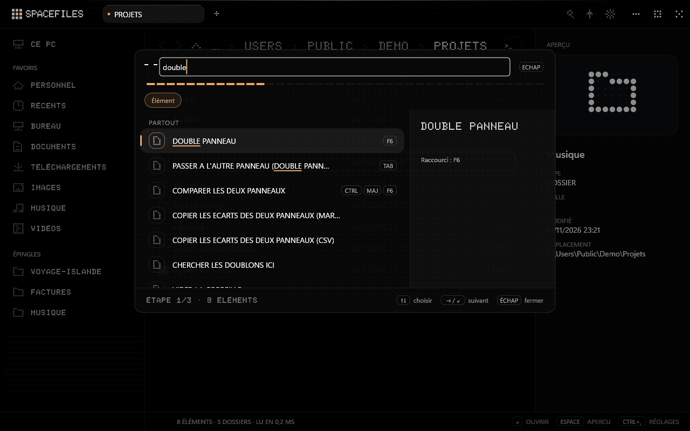
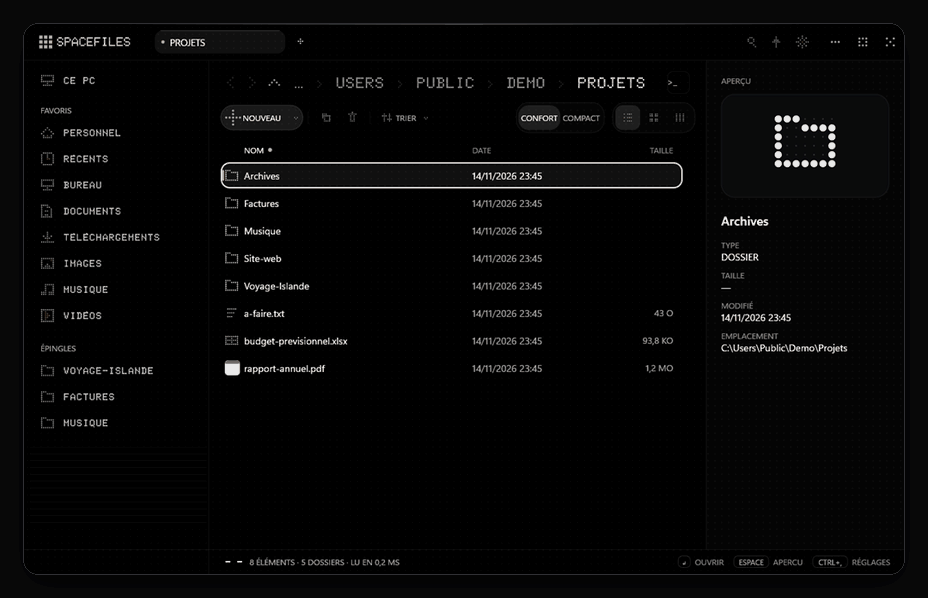
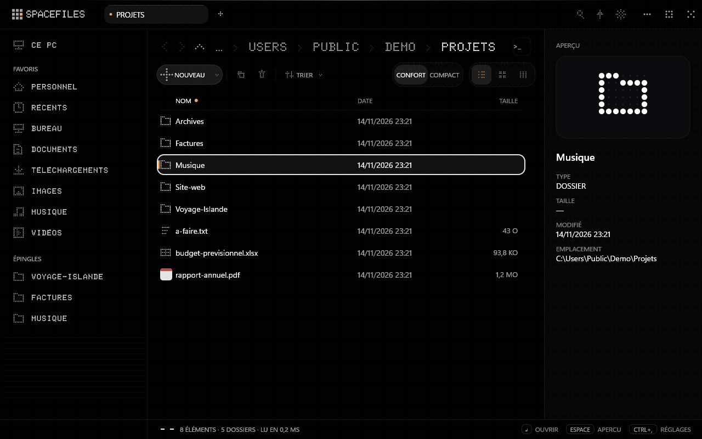
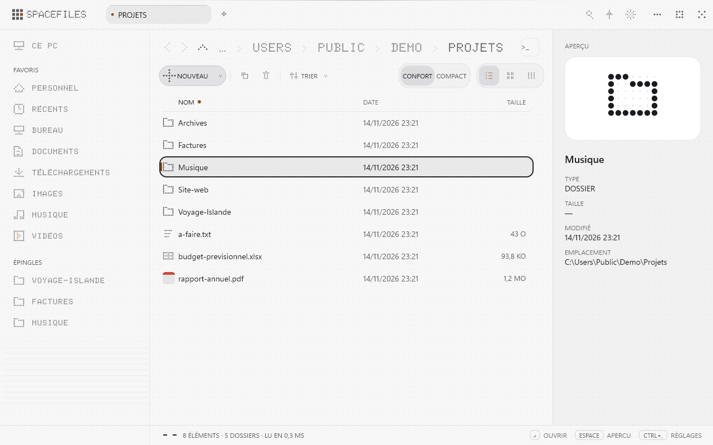
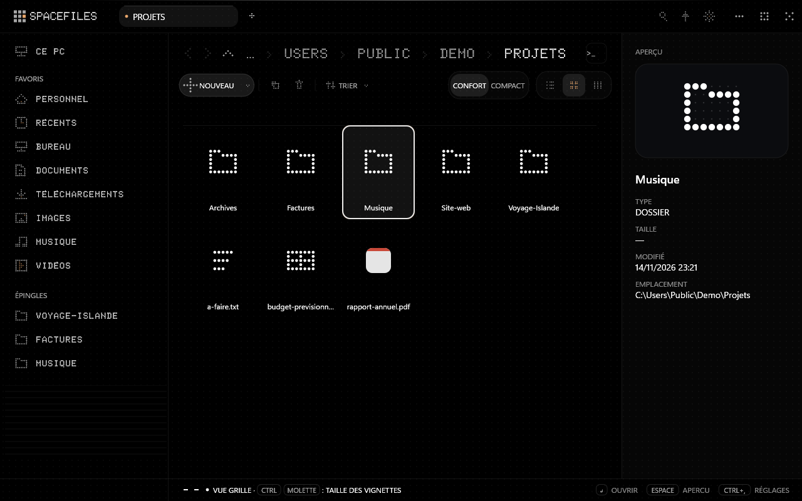
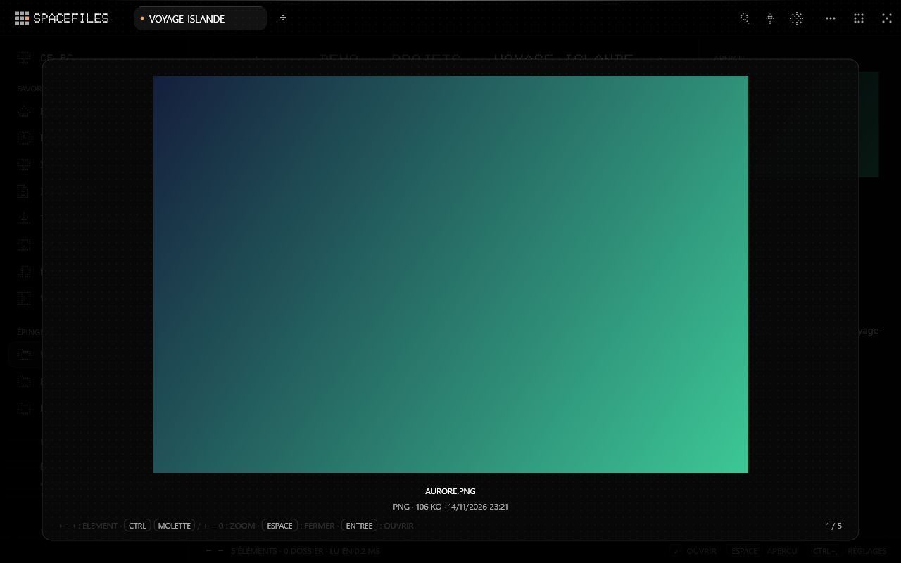

<p align="right"><b>English</b> · <a href="README.fr.md">Français</a></p>

<p align="center">
  
</p>

<h3 align="center">The file explorer for Windows 11 that you can read at a glance.</h3>

<p align="center">
  Dual pane. Command palette. Real undo. Dot-matrix look.<br>
  <sub>Rust, raw Win32, Direct2D · no UI framework · no telemetry · 4.4 MB</sub>
</p>

<p align="center">
  <a href="https://github.com/nicoo-o/SpaceFiles/releases/latest"></a>
  &nbsp;
  <a href="#build-it-yourself"></a>
</p>

<p align="center">
  
  
  
  
  
  
  <a href="LICENSE"></a>
</p>

<p align="center">
  <a href="#why-it-exists">Why</a> ·
  <a href="#what-you-get">Features</a> ·
  <a href="#see-it">Screenshots</a> ·
  <a href="#versus-file-explorer">Versus File Explorer</a> ·
  <a href="#can-i-trust-an-unsigned-exe">Trust</a> ·
  <a href="#build-it-yourself">Build</a> ·
  <a href="#known-limits">Limits</a>
</p>

<p align="center">
  
</p>

<p align="center">
  <br>
  <sub>A tour of five views (list, grid, dual pane, palette, quick look), assembled from real screenshots of a demo folder.</sub>
</p>

---

## Why it exists

> Windows' File Explorer is built for everyone. SpaceFiles is built for one person who wants to move through folders
> with the keyboard, see two places at once, undo a mistake, and have the whole thing look like a Nothing phone.

One borderless black window, one dot-matrix font (Doto), menus that shout politely in capitals. It is the file
explorer of the [Space suite](https://github.com/nicoo-o): small, native, private Windows apps that work together.
It was called *Nothing Explorer* until November 2026.

## What you get

<table>
<tr>
<td width="33%" valign="top">

**🪟 Dual pane**<br>
<kbd>F6</kbd> splits the window. Compare two folders, sync them with <kbd>Ctrl</kbd>+<kbd>Shift</kbd>+<kbd>F6</kbd>, copy the differences as Markdown.

</td>
<td width="33%" valign="top">

**⌨️ Command palette**<br>
<kbd>Ctrl</kbd>+<kbd>K</kbd> and type. Every command, one keystroke away. Editable path with <kbd>Ctrl</kbd>+<kbd>L</kbd>.

</td>
<td width="33%" valign="top">

**👁 Quick look**<br>
<kbd>Space</kbd> on a file shows it. On a folder it computes the size. Plus a preview pane.

</td>
</tr>
<tr>
<td valign="top">

**↩️ Real undo**<br>
Copy, move and recycle go through Windows' own `IFileOperation`: <kbd>Ctrl</kbd>+<kbd>Z</kbd> / <kbd>Ctrl</kbd>+<kbd>Y</kbd>, 50 steps deep. Queue with pause and resume.

</td>
<td valign="top">

**🔎 Fast search**<br>
Type to filter, <kbd>Ctrl</kbd>+<kbd>F</kbd> to search below. Home-made index: 2.5 million items in about 4 min 30 s, 110 MB.

</td>
<td valign="top">

**🎨 Three views, two themes**<br>
List, grid, Miller columns. Dark, light or auto. Reduced motion switches every animation off.

</td>
</tr>
</table>

<details>
<summary><b>More details</b> (tabs, tags, rename, downloads, the Pixel)</summary>

- **Tabs**: <kbd>Ctrl</kbd>+<kbd>T</kbd> / <kbd>W</kbd> / <kbd>Tab</kbd>; sessions are saved 2 s after any change and reopened after a crash.
- **Index filters**: `ext:` `taille>` `modif:` `dossier:` `dans:` `contenu:` (yes, in French; so is the whole app).
- **Batch rename** with regular expressions, tags (<kbd>Ctrl</kbd>+<kbd>1</kbd>/<kbd>2</kbd>/<kbd>3</kbd>), pins, SHA-256, archives.
- **Conflict view** side by side, and a 16-bar gauge that ends in `ANNULER · CTRL Z`.
- **Browser downloads** are watched: partial `.crdownload` and `.part` files get their own pill, finished ones a `NOUVEAU` mark.
- **Pixel**: two bars in the status bar. They change colour with the hour and close their eyes at night. Not a mascot: a status light.
- <kbd>Win</kbd>+<kbd>E</kbd> opens SpaceFiles when the small resident process is running.

</details>

## See it

<p align="center">
  
  
  
  
  
  
</p>
<p align="center"><sub>A demo folder with made-up files. The interface is in French (see the known limits).</sub></p>

## Versus File Explorer

Not a verdict: a list of what differs. Windows' own File Explorer is better integrated with the shell, the cloud
and every other program; SpaceFiles does not try to replace that.

| | File Explorer (Windows 11) | SpaceFiles |
|---|---|---|
| Dual pane | no | **yes** (<kbd>F6</kbd>), with folder comparison |
| Miller columns | no | **yes** |
| Command palette | no | **yes** (<kbd>Ctrl</kbd>+<kbd>K</kbd>) |
| Search | Windows Search index | home-made index, with filters |
| Interface | system | dot-matrix, one font, dark and light |
| Language | your system language | French only |
| Signed by Microsoft | **yes** | no |

## Download

**[▶ Latest release](https://github.com/nicoo-o/SpaceFiles/releases/latest)**: `SpaceFiles-v0.1.0-portable.zip` and
`SHA256SUMS.txt`. Unzip, run `spacefiles.exe`. Windows 11. This is a first pre-release: not signed, not updated
automatically.

## Can I trust an unsigned exe?

You are asked to run a program from a stranger. Here is what is true, and how to check it yourself.

<details>
<summary><b>Open the checklist</b></summary>

- **Windows will warn you.** The exe has no code-signing certificate (it costs money; see
  [`docs/release/signature-et-mises-a-jour.md`](docs/release/signature-et-mises-a-jour.md)). SmartScreen shows
  "Windows protected your PC": click **More info**, then **Run anyway**. Smart App Control, if enabled, may refuse
  the file outright; that is Windows' rule, not something to bypass here.
- **Check the file.** The release carries `SHA256SUMS.txt`. In PowerShell:
  `Get-FileHash .\SpaceFiles-v0.1.0-portable.zip -Algorithm SHA256` must print the same hash.
- **No telemetry, no account, no update check.** The only outgoing connection in the code is a port-445
  reachability test toward a network storage you configured yourself.
- **What it writes.** Settings and caches go to `%APPDATA%\SpaceFiles` and `%LOCALAPPDATA%\SpaceFiles`. In the
  source, the only code that writes to the registry is the optional "default explorer" setting
  (<kbd>Win</kbd>+<kbd>E</kbd>); the zip has no installer.
- **Read the code.** It is all here, under the MIT licence. Windows 10 has not been tested.

</details>

## Measured, not claimed

| What | Measured | Note |
|---|---|---|
| Executable | **4.43 MB** (4,433,920 bytes) | release build, LTO, `panic = abort`, Doto font embedded (+0.46 MB), 14 November 2026 |
| Resident process | **16 MB** working set | the part that stays in memory for <kbd>Win</kbd>+<kbd>E</kbd> |
| Folder of 200,000 entries | listed in **0.9 s**, 195 MB | one single measurement, not an average |
| Index of 2.5 million items | ~4 min 30 s, 110 MB | low-priority crawl |
| Tests | **692 passed**, 0 failed, 8 ignored | `cargo test`, 14 November 2026 |
| Direct dependencies | 4 crates (30 in total) | `windows`, `windows-core`, `regex`, `webview2-com` |

## Part of the Space suite

<details>
<summary><b>How the apps talk to each other</b></summary>

SpaceFiles talks to the other Space apps through named pipes restricted to the current user
(`Eco.<app>.<user>`, JSON lines), a manifest, and one shared settings file. No listening port, no account.

- [**SpaceHub**](https://github.com/nicoo-o/SpaceHub): the meeting point of the suite. It lists the apps, their
  versions and their health, and holds the shared theme and motion settings that SpaceFiles follows.
- [**SpaceNotch**](https://github.com/nicoo-o/SpaceNotch): the Dynamic Island for Windows 11. It can ask SpaceFiles
  for file searches, and SpaceFiles sends it the progress of its operations. <kbd>Alt</kbd>+<kbd>Space</kbd> belongs
  to SpaceNotch; that is why the palette here is <kbd>Ctrl</kbd>+<kbd>K</kbd>.
- The contract is written in [`docs/ecosystem/protocol.md`](docs/ecosystem/protocol.md). The Hub is never
  required, and no app launches another one to work.

</details>

## Build it yourself

Windows 11 and a Rust toolchain. Nothing else to install.

```powershell
cargo build --release      # target\release\spacefiles.exe
cargo test                 # about half a minute
./installer.ps1            # copies the exe to %LOCALAPPDATA%\Programs\SpaceFiles, shortcut and icon
```

Read [`docs/installation.md`](docs/installation.md) before running the installer: it explains what is written
and how `desinstaller.ps1` removes it (your data is kept unless you ask otherwise).

## Known limits

- **Pre-release, no signed binary, no auto-update.** The exe triggers SmartScreen. WebView2 is optional (HTML preview only).
- **The zip is portable: no installer.** `installer.ps1` only works from a source checkout (shortcut, resident process, <kbd>Win</kbd>+<kbd>E</kbd>).
- **French only.** Interface, comments and documentation are in French. The filters above are not a typo.
- SFTP, WebDAV, NAS backup and MTP are frozen behind an `experimental` setting, off for a new profile.
- Not covered by automated checks: anything that needs a real mouse (hover, right-click menu, lasso), a second screen with another DPI, full screen.
- The full list, unsoftened, is at the end of [`CHANGELOG.md`](CHANGELOG.md).

<details>
<summary><b>What SpaceFiles will not do</b></summary>

- **No account, no remote service**: no Drive, Dropbox or iCloud, and no file sent to a model.
- **No telemetry, no personalised recommendations**: the "recommended" pane of File Explorer is not a goal.
- **No background auto-update**: the binary is replaced by hand.
- **No home-grown archive engine**: `tar.exe` covers zip, tar and 7z both ways.
- **No extension marketplace, no mobile companion**: one author, one binary.

</details>

## About

Built by one person, with a lot of help from coding agents; [`AGENTS.md`](AGENTS.md) is the rulebook they follow,
and a decent tour of the code for humans too. The dotted title is generated by
[`tools/readme/titre.mjs`](tools/readme/titre.mjs).

[MIT](LICENSE). The fonts in `assets/fonts` keep their own licences.

<p align="center"><sub>If this is your kind of tool, a ⭐ helps others find it.</sub></p>
